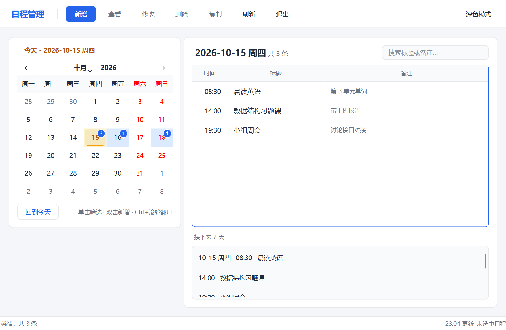

# Python 日程管理系统

<div align="center">

**基于 Python + PySide6 的桌面日程管理工具**

[](https://www.python.org/)
[](https://doc.qt.io/qtforpython/)
[]()
[]()
[]()

</div>

## 📖 项目简介

一个用 Python 编写的图形化日程管理系统，支持日程的添加、查看、修改、删除和按日期筛选，并对非法输入、未选中记录、删除确认和存储异常给出友好提示。

项目采用 PySide6 实现 Windows 桌面界面，SQLite 负责本地持久化；界面、服务层、存储层与组合根彼此分离，交互规则可以脱离 GUI 单独测试。

> **当前状态**：界面层、服务层与 SQLite 存储已完成，默认入口写入真实数据库；Windows 上的最终字体、DPI、原生样式与截图验收待人工完成。

## ✨ 核心特性

- 🗓️ **日程管理**：新增、查看、修改、删除，按选中日期展示当天全部日程；
- 🌤️ **全天日程**：时间留空即为全天，列表显示“全天”，并排在同日定时日程之前；
- 📅 **日历筛选**：左侧月历选择日期，右侧列表实时刷新；
- 🔎 **全局搜索**：顶部搜索框按标题或备注查找全部日程，结果带日期列、可跨日期查看与修改；`%`、`_` 等字符按字面量匹配，清空即回到当天；
- 🗓️ **未来 7 天摘要**：左侧日历下方列出今天起 7 天的日程，点击条目跳到对应日期并选中该条；
- 🟦 **日历日程标记**：有日程的日期显示底色与条数徽标（超过 9 条显示 `9+`），翻月自动刷新当月标记；
- ⭐ **今天高亮**：今天在日历上以琥珀色标记，顶部显示「今天 · 日期」，随时可点「回到今天」；
- 🌗 **深色模式**：工具栏一键切换浅色 / 深色主题，选择写入本地设置，重启后保持；
- 🖱️ **双击日历新增**：双击某个日期直接打开「新增日程」表单，日期自动预填；
- ✍️ **宽容输入**：`2026/10/15`、`2026.10.15`、`2026年10月15日`、`9:05` 等写法由服务层统一解析；
- 💾 **本地持久化**：SQLite 存储，重启程序后数据仍在；
- 🛡️ **友好错误提示**：区分输入错误、记录不存在、重复 ID 与存储故障，不向用户泄露堆栈；
- 🧱 **分层架构**：`ui → application → domain`，`infrastructure` 实现仓储契约，`composition.py` 负责装配；
- ✅ **自动化测试**：357 条测试覆盖交互规则、解析、CRUD、契约、SQLite 集成与入口装配。

## 🚀 快速开始

### 环境要求

- **操作系统**：Windows 10/11（64 位，GUI 目标平台）；
- **Python**：3.12 或更高版本，由 uv 自动下载和管理；
- **uv**：负责虚拟环境、依赖与锁文件；
- **磁盘**：首次安装 PySide6 约需 650 MB。

没有 uv 时，先按 [开发与验证](docs/development.md) 安装。Linux 可以运行测试、静态检查与后端代码，但不作为 GUI 验收平台。

### 从源码运行

```powershell
git clone git@github.com:Ghost-king-gk/SDMS.git
cd SDMS

uv sync --frozen
uv run python -m schedule_management.ui.app
```

首次启动是空库，数据库文件位于：

```text
%LOCALAPPDATA%\sdms\schedules.db
```

想清空数据重来时，关闭程序后删除该文件即可。需要演示数据/截图时使用内存替身，不写入数据库：

```powershell
uv run python -c "from schedule_management.ui.app import main; main(seed_demo_data=True)"
```

## 📸 界面预览

<p align="center">
  
</p>

> 截图为演示数据下的界面预览；默认入口使用 SQLite，首次启动为空列表。

## 📚 文档

| 文档 | 内容 |
| --- | --- |
| [需求基线](docs/requirements.md) | 功能/非功能需求与课程交付要求 |
| [开发与验证](docs/development.md) | 环境配置、构建、测试、验证结果与架构状态 |
| [协作快速指南](docs/collaboration.md) | 分支、PR、提交前检查与 AI 提示词 |
| [完整协作协议](GITHUB_COLLABORATION.md) | Git/GitHub 基础、Issue/PR 流程、冲突处理 |
| [界面设计](docs/figures/ui-interaction.md) | 布局、交互规则、验收清单与选型理由 |
| [团队契约](docs/design/contracts.md) | 服务/仓储签名、错误类型、解析规则、前端接入清单 |
| [截图说明](docs/screenshots/README.md) | 截图环境、操作步骤与结果 |
| [设计文档目录](docs/design/README.md) | 各成员 Word 设计文档说明 |
| [演示文档目录](docs/presentation/README.md) | 组级 PowerPoint 说明 |

## 🛠️ 技术栈

- **语言**：Python 3.12+
- **界面**：PySide6（Qt for Python）
- **存储**：SQLite（标准库 `sqlite3`）
- **依赖管理**：uv + `uv.lock`
- **测试与质量**：pytest、ruff、mypy（strict）

## 📂 项目结构

```text
.
├── src/schedule_management/
│   ├── domain/            # 日程模型与领域不变量
│   ├── application/       # 服务层、宽容解析、仓储契约
│   ├── infrastructure/    # SQLite 仓储适配器
│   ├── ui/                # 交互规则 + PySide6 窗口
│   ├── composition.py     # 数据库连接与服务装配
│   └── dev_stub_service.py# 演示用内存替身
├── tests/                 # 单元、契约、集成测试
├── docs/                  # 设计、图表、截图、评审
├── scripts/               # 环境探测与截图脚本
├── Requests/              # 原始需求（只读）
├── pyproject.toml / uv.lock
└── README.md
```

## 🧪 测试

```bash
uv run python -m compileall src
uv run ruff check .
uv run ruff format --check .
uv run mypy src
uv run pytest -q                  # 357 passed
```

详细的环境配置、Windows/Linux 差异、测试明细与验证结果见 [`docs/development.md`](docs/development.md)。

## 🤝 贡献

从 `main` 创建个人分支，完成一个清晰的小任务后通过 Pull Request 请求审查和合并；不要直接 push `main`。分支命名、Conventional Commits、PR 描述、冲突处理和 AI 协作提示词见：

- [协作快速指南](docs/collaboration.md)
- [完整协作协议](GITHUB_COLLABORATION.md)
- [项目开发规范](AGENTS.md)

## 📄 许可证

本项目为课程作业，仓库未附开源许可证；代码与文档仅供课程评审使用，如需复用请先联系作者。

## 🙏 致谢

- [PySide6](https://doc.qt.io/qtforpython/) / Qt：桌面界面与跨平台控件；
- [uv](https://docs.astral.sh/uv/)：Python 版本、依赖与虚拟环境管理；
- pytest、ruff、mypy：测试与质量门禁；
- 课程指导教师与三位组员在需求、设计和联调中的协作。
- [DeepSeek](https://www.deepseek.com/): DeepSeek-v4.1-flash 与 DeepSeek-v4.1-flash-1017 提供指导、需求分析、文档、教程书写与代码检查。
- [WorkBuddy](https://www.workbuddy.ai/)：Harness for LLMs
- [Hermes](https://github.com/NousResearch/hermes-agent): Harness for LLMs
- [Codex Desktop](https://github.com/openai/codex) Harness for LLMs
- [Copilot](https://copilot.com/): Harness for LLMs and repo management

